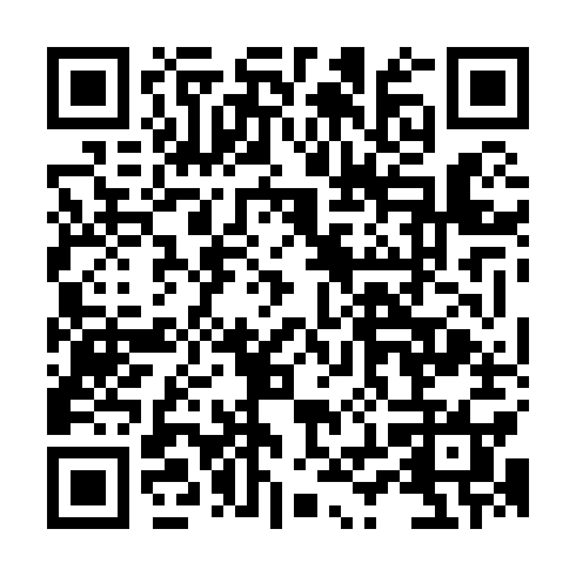

# Scholarly Prompt Lab

**The prompt as method.** A free, open-source, offline-capable tool for designing, documenting and evaluating AI prompts in digital humanities research.

When scholars hand interpretive work to a generative AI system, the wording of the prompt becomes part of how knowledge is produced. Change the prompt and you may change the history the machine tells. The Scholarly Prompt Lab treats the prompt as a research instrument: something to design with care, test for stability, and document so that others can audit it.

It is for scholars in the humanities and social sciences anywhere in the world. It takes particular care with languages, histories and knowledge traditions that are under-represented in AI training data, where a model's errors are most likely and hardest for an outsider to see: diacritics and tone marks are preserved and checked, indigenous-language terms are kept in their original form, and culturally sensitive readings are flagged for expert review.

## What it does

| Tab | Purpose |
|---|---|
| **Build** | Turn a research question into a structured scholarly prompt: theory, technique, sources, cultural context, contested terms, output format and safeguards. A live meter shows how much of the CONTEXT framework the design covers. |
| **Sensitivity study** | Generate the same task under four conditions (baseline, theory-grounded, context-grounded, evidence-constrained) with an identical output specification, so the results can be compared. Download a full study protocol. |
| **Log & evaluate** | Paste an AI system's response and the Lab checks it automatically against your own sources: every quotation is marked exact, near (with the real wording shown) or not found; dropped Igbo or Yoruba diacritics, cited documents that are not loaded, names and numbers from outside the source, missing alternative readings and copy-paste debris are all flagged. These findings fill an **Errors found** list for the scholar to review. Scores for traceability, plurality and calibration are **suggested** with their reasons; an optional **second-model evaluation** suggests scores for accuracy, context and misrepresentation. Every suggestion must be confirmed or changed by the scholar, only confirmed scores are averaged, and the Lab records how often the scholar agreed with each kind of suggestion. Export JSON, CSV or a Markdown report. |
| **Methods report** | Drafts a report of your AI-assisted methods from what you recorded: an AI-use statement for journals and theses, a methods section (systems, versions and dates; how the prompt was designed; runs; checks and what they found; your evaluation; how the output was used; limitations) and appendices with every prompt, the log, errors found and references. Editable in the page, then downloaded for Word or saved as PDF. It states only what was recorded and marks anything missing as *To complete*. |
| **CONTEXT framework** | The framework behind the tool, and four roles AI can play in humanities research. |

**Bring your own material.** Paste your own research question and texts, or use *Load your own files* to add PDF, Word (.docx) or plain-text files (.txt, .md, .csv, transcripts). Before anything is used, you see the extracted text, can correct it, and can untick files you do not want. Each file is tagged `[DOC-01: filename]`, `[DOC-02: …]`, and PDFs get page markers `[p. 1]`, so the model can cite them. Files are read inside your browser and never uploaded.

| File type | Supported? | Notes |
|---|---|---|
| Word (.docx) | Yes | Tables and footnotes become plain text. |
| Old Word (.doc) | No | Save as .docx first. |
| PDF with selectable text | Yes | Check that columns, footnotes and headers came out in the right order. |
| Scanned PDF (image of a page) | No | Needs text recognition (OCR) first. The Lab detects these and warns you. |
| Plain text, Markdown, CSV, subtitles | Yes | |

**Procedures that follow your method.** The analytical procedure is built from your choices, not from a fixed template: your discipline contributes its conventions (source criticism for history, glossing for linguistics, performance context for oral literature, and so on); each chosen framework contributes the steps of its own method (for example description, interpretation and explanation for Fairclough, or the four framing functions for Entman); and the technique sets how evidence is handled. A research-design block records the unit of analysis, the corpus and working definitions. Standards are grouped under Evidence, Interpretation, Context and Limits. When the model is asked to answer from its own knowledge, the Lab drops the demand for quotations, which would push it to invent them, and it warns about designs that contradict themselves. Every generated step can be edited, and the Lab never overwrites your edits.

**Disciplines.** Choose from 80 disciplines in six groups (humanities; arts and heritage; communication and media; social sciences; area and identity studies; interdisciplinary and digital), search by typing, or add your own.

**Theory library.** Choose from 176 entries across twelve fields: communication and media; language and discourse; literature, orality and translation; history and memory; African, postcolonial and decolonial thought; gender, race and intersectionality; philosophy and ethics; sociology, anthropology and cultural studies; visual, material and performance culture; religion; digital and data studies; and analytical approaches. Each entry is typed (theory, framework, approach, method, concept, school, movement or critique) and gives one to three key works in Harvard author-date style, the framework's own core concepts and, for contested positions, well-known critiques. All 427 references were checked against library catalogues: 383 were confirmed, and the rest are marked in the Lab. See [how the library was compiled and checked](docs/theory-library.md). Search by name, thinker or idea, filter by field, and combine several theories in one design. You can add your own theories: they are saved in your browser, travel with exported designs, and can be suggested for the shared library with one click. If a theory you add is already in the library, the Lab points you to the existing entry. You can also **propose** your theory or discipline for every user: proposals are checked automatically, reviewed by the editor like submissions to a journal, and, if accepted, appear in the Lab for everyone with credit to you. With one theory selected, the Lab suggests companion theories, drawing on common scholarly pairings and on the words in your research question and loaded material, and says why each was suggested.

Seven worked examples are included, from different regions and disciplines: the 1857 uprising in India, the 1929 Women's War in Nigeria, English translations of a Bashō haiku, an Igbo proverb, newspaper editorials on immigration, interviews with care workers, and AI images of Tenochtitlan.

## Privacy

The Lab runs entirely in the browser. It sends nothing to any server, calls no AI model, and needs no account or API key. The PDF and Word readers (PDF.js and Mammoth, in `vendor/`) are part of the Lab itself and also run on your machine. Your work is saved only in your own browser's local storage. Export it to keep a copy or move it to another device.

This matters for research involving oral histories, interview transcripts or unpublished archives: nothing leaves your machine unless you paste it into an AI system yourself.

## Use it

- **Online:** <https://thefrankonuh.github.io/scholarly-prompt-lab/>

  

- **Offline:** download the repository (Code → Download ZIP), unzip it, and open `index.html` in any modern browser. No installation needed. Everything works offline except reading PDFs, which browsers only allow when the page is served from a web address. To read PDFs offline, run `python -m http.server` in the folder and open <http://localhost:8000>.

## The CONTEXT framework

| | Dimension | Question |
|---|---|---|
| **C** | Conceptual grounding | What am I investigating, and through which concepts? |
| **O** | Operationalisation | What operations should the model perform, step by step? |
| **N** | Situated knowledge | Whose knowledge is this, in which language, and what will an outsider misread? |
| **T** | Traceability | Can every claim be followed back to a source I can check? |
| **E** | Evaluation | How will I judge whether the output is defensible, and who else should judge it? |
| **X** | Cross-model examination | Does the finding survive a different model, wording or language? |
| **T** | Transparency | Could another scholar reproduce or audit what I did? |

The full guide is in [docs/CONTEXT-framework.md](docs/CONTEXT-framework.md). The framework is offered as a proposal, open to evaluation and refinement.

## Limitations

- The Lab structures and records your method. It cannot tell you whether an output is true. The automatic checks compare the output with the source text you supplied; they do not judge interpretations, and they cannot check claims against evidence you did not load. A second-model evaluation is another AI's opinion, so it is recorded as a suggestion, never as a final score. That judgement needs independent evidence and, for culturally situated material, people with the relevant linguistic and cultural expertise.
- A more elaborate prompt can improve an output, introduce new errors, or encourage a model to agree with you. The sensitivity study exists to find out which.
- AI-generated images are model outputs. They are never evidence of what the past looked like.
- The summary averages are descriptive. With a handful of runs they do not support statistical claims.

## Contributing

Contributions are welcome, especially worked examples from other disciplines and languages, translations of the interface, and new evaluation criteria. See [CONTRIBUTING.md](CONTRIBUTING.md).

The tool is plain HTML, CSS and JavaScript with no build step. Reference data (disciplines, theories, techniques, safeguards, examples) lives in `data.js`.

## Author

Created by [Frank Onuh](https://www.linkedin.com/in/frank-onuh/).

## Licence

Code: [MIT](LICENSE). Documentation and the CONTEXT framework guide: [CC BY 4.0](https://creativecommons.org/licenses/by/4.0/). Bundled libraries keep their own licences: PDF.js (Apache 2.0) and Mammoth (BSD 2-Clause); see [vendor/README.md](vendor/README.md).

If you use the Lab or the framework in research, please cite it:

> Onuh, F. (2026). *Scholarly Prompt Lab: The Prompt as Method* (Version 0.5.0) [Computer software]. Zenodo. https://doi.org/10.5281/zenodo.24521711

The DOI above always points to the latest version. Each release also has its own DOI on [Zenodo](https://doi.org/10.5281/zenodo.24521711). See also [CITATION.cff](CITATION.cff).
